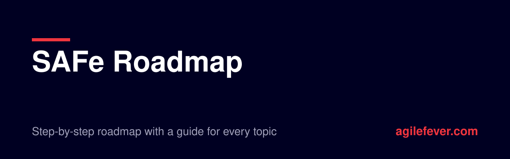

# SAFe Roadmap

> SAFe Roadmap - A step-by-step roadmap to learn the Scaled Agile Framework (SAFe) and choose the right SAFe certification at the right time, with a blog for every topic

## Table of Contents

- [What is SAFe?](#what-is-safe)
- [The SAFe Certification Path](#the-safe-certification-path)
- [How to Use This Roadmap](#how-to-use-this-roadmap)
- [Step 0: Must Know](#step-0-must-know)
- [Step 1: Why SAFe and When to Use It](#step-1-why-safe-and-when-to-use-it)
- [Step 2: Lean-Agile Mindset, Core Values, and Principles](#step-2-lean-agile-mindset-core-values-and-principles)
- [Step 3: Team and Technical Agility](#step-3-team-and-technical-agility)
- [Step 4: Agile Product Delivery and PI Planning](#step-4-agile-product-delivery-and-pi-planning)
- [Step 5: Lean Portfolio Management](#step-5-lean-portfolio-management)
- [Step 6: Leading SAFe (SA), Your First Certification](#step-6-leading-safe-sa-your-first-certification)
- [Step 7: SAFe Scrum Master (SSM)](#step-7-safe-scrum-master-ssm)
- [Step 8: SAFe Product Owner / Product Manager (POPM)](#step-8-safe-product-owner--product-manager-popm)
- [Step 9: Release Train Engineer (RTE)](#step-9-release-train-engineer-rte)
- [Step 10: Specialist Courses: Teams, DevOps, Architects, Engineering](#step-10-specialist-courses-teams-devops-architects-engineering)
- [Step 11: Implementing SAFe (SPC)](#step-11-implementing-safe-spc)
- [Step 12: Choose Your Order and Prepare for the Exams](#step-12-choose-your-order-and-prepare-for-the-exams)
- [Learn This Roadmap with a Mentor](#learn-this-roadmap-with-a-mentor)
- [License](#license)

### Prepared and maintained by [AgileFever](https://agilefever.com)

### Follow AgileFever

- [LinkedIn](https://www.linkedin.com/company/agilefever/)
- [YouTube](https://www.youtube.com/@AgileFever)
- [X](https://x.com/agilefever)
- [Website](https://agilefever.com)

## Learn with AgileFever

- [AI-Empowered Leading SAFe (SA)](https://agilefever.com/agile/leading-safe-certification-training/)
- [AI-Empowered SAFe Scrum Master (SSM)](https://agilefever.com/agile/safe-scrum-master-ssm-certification-training/)
- [AI-Empowered SAFe Product Owner/Product Manager (POPM)](https://agilefever.com/agile/safe-product-owner-manager-popm-certification-training/)
- [AI-Empowered SAFe Release Train Engineer (RTE)](https://agilefever.com/agile/rte-training-safe-release-train-engineer-certification/)
- [AI-Empowered Implementing SAFe (SPC)](https://agilefever.com/agile/implementing-safe-spc-certification-training/)

---

> **Note: We will keep updating this roadmap with new topics and blogs.**

---

### What is SAFe?

The Scaled Agile Framework (SAFe) is a set of practices, roles, and events that help large organizations deliver software and products with Agile teams working in step with each other. Scrum and Kanban work well for one team. SAFe answers the next question: how do 50, 100, or 500 people plan together, release together, and stay tied to business strategy?

In simple words, SAFe gives an organization:

- **A shared rhythm:** teams plan in Program Increments (PIs), usually 8 to 12 weeks, and work in short iterations inside each one.
- **A way to organize around value:** work is grouped into value streams and delivered by Agile Release Trains (ARTs), which are teams that plan and release together.
- **A link from strategy to teams:** Lean Portfolio Management connects funding and priorities to the work the teams do.
- **A common language:** roles such as Product Owner, Product Manager, Scrum Master, and Release Train Engineer mean the same thing across teams.

Scaled Agile, Inc. owns SAFe and runs the certification exams. AgileFever teaches the courses. This roadmap follows the order in which most people learn SAFe: ideas first, then one certification at a time, in the order that fits the role.

### The SAFe Certification Path

Pick the certification that matches your role. Most people start with Leading SAFe and then take one role course.

| If you are a... | Take this | What it covers |
| --- | --- | --- |
| Leader, manager, architect, business analyst, or anyone new to SAFe | [Leading SAFe (SA)](https://agilefever.com/agile/leading-safe-certification-training/) | The SAFe mindset, values, principles, team and technical agility, Agile product delivery |
| Scrum Master or team coach | [SAFe Scrum Master (SSM)](https://agilefever.com/agile/safe-scrum-master-ssm-certification-training/) | Scrum in a SAFe enterprise, team events, supporting ART events |
| Product Owner or Product Manager | [SAFe POPM](https://agilefever.com/agile/safe-product-owner-manager-popm-certification-training/) | PI Planning preparation, backlogs, iteration and PI execution |
| Release Train Engineer or aspiring RTE | [SAFe RTE](https://agilefever.com/agile/rte-training-safe-release-train-engineer-certification/) | Facilitating the ART, PI events, flow, metrics, release on demand |
| Change agent, consultant, or coach | [Implementing SAFe (SPC)](https://agilefever.com/agile/implementing-safe-spc-certification-training/) | Leading a SAFe transformation, launching ARTs, portfolio and enterprise rollout |

Specialist courses also exist for [SAFe for Teams](https://agilefever.com/agile/safe-for-teams-certification-training/), [DevOps](https://agilefever.com/agile/safe-devops-certification-training/), [Architects](https://agilefever.com/agile/safe-for-architects-certification-training/), [Lean Portfolio Management](https://agilefever.com/agile/safe-lean-portfolio-management-certification-training/), and [Agile Software Engineering](https://agilefever.com/agile/safe-agile-software-engineering-certification-training/).

### How to Use This Roadmap

This roadmap is designed so that anyone can follow it in the given order, even without any prior SAFe background.

- Follow the steps in order. Each step builds on top of the previous one.
- Steps 0 to 5 are the concepts. Steps 6 to 11 are the certifications. Read the concept steps first, then jump to the certification that matches your role.
- Inside each step, read the blogs in the given order. Every blog explains one idea in plain words.
- After every step, ask yourself: "Could I explain this to a teammate tomorrow?" If yes, move on.
- SAFe courses at AgileFever are now AI-Empowered versions. The certification topics stay the same, with AI added to how you apply them. Check the course page for the current wording.

Let's get started.

### Step 0: Must Know

Before going deep, we need a few words that appear in every SAFe conversation. Learn them first and the rest of the roadmap will read much easier.

- [What is the difference between Agile and Scrum?](https://agilefever.com/what-is-the-difference-between-agile-and-scrum/)
- [What is the difference between Agile and SAFe Agile?](https://agilefever.com/what-is-the-difference-between-agile-and-safe-agile/)
- [What is SAFe, and when should an organization use it?](https://agilefever.com/what-is-safe-scaled-agile-framework/)
- Agile Release Train (ART)
- Program Increment (PI)
- Value stream
- Business agility

### Step 1: Why SAFe and When to Use It

SAFe is not the answer for every team. In this step, we will learn what SAFe gives us, where it costs us, and how it compares with other options, so that we can make a fair decision.

- [SAFe vs Scrum: choosing the right framework](https://agilefever.com/safe-vs-scrum-deciding-on-the-best-agile-framework/)
- [SAFe vs LeSS: the key differences](https://agilefever.com/what-is-the-difference-between-safe-and-less/)
- [Pros and cons of the SAFe framework](https://agilefever.com/the-ultimate-guide-to-pros-and-cons-safe-framework/)
- [Agile vs SAFe Agile: the contrast](https://agilefever.com/agile-vs-safe-agile-key-differences-revealed/)
- [Is SAFe certification worth pursuing?](https://agilefever.com/safe-agile-certification-guide-is-it-worth-it/)
- [SAFe 5.1 vs SAFe 6.0](https://agilefever.com/safe-5-1-vs-safe-6-0-course-comparison-guide/)
- [SAFe 6.0 for scaled Agile organizations](https://agilefever.com/safe-60-revolutionizing-scaled-agile-organizations/)

### Step 2: Lean-Agile Mindset, Core Values, and Principles

This is the base of every SAFe course. The mindset, the four core values, and the Lean-Agile principles explain why the practices exist. Leading SAFe spends roughly a third of its time here.

- [SAFe Lean-Agile principles](https://agilefever.com/mastering-safe-lean-agile-principles-expert-guide/)
- [The four SAFe core values](https://agilefever.com/demystifying-safe-core-values/)
- [Core values of the Scaled Agile Framework](https://agilefever.com/what-are-the-core-values-of-the-scaled-agile-framework/)
- [Mastering SAFe methodology for business agility](https://agilefever.com/mastering-safe-methodology-business-agility-strategies/)
- [Building an Agile team: key steps](https://agilefever.com/key-steps-to-building-an-agile-team/)
- [Benefits of working with an Agile coach](https://agilefever.com/8-key-benefits-of-using-an-agile-coach/)

### Step 3: Team and Technical Agility

Teams are where SAFe work gets done. In this step, we will learn the roles on an Agile team, the events they run, and how Scrum and Kanban fit inside SAFe. These topics are the core of the SAFe Scrum Master course.

- [Roles and responsibilities in SAFe](https://agilefever.com/demystifying-roles-in-safe-framework/)
- [SAFe ceremonies and events](https://agilefever.com/master-safe-ceremonies-the-ultimate-guide/)
- [How Kanban is used inside SAFe](https://agilefever.com/ways-kanban-is-used-in-safe-a-powerful-agile-tool-for-effective-workflow-management/)
- [Built-in quality and technical practices: SAFe Agile Software Engineering](https://agilefever.com/safe-agile-software-engineering-certification/)
- [Conversations that build better working relationships in SAFe](https://agilefever.com/expert-tips-for-mastering-safe-conversations/)
- Cross-functional Agile teams

### Step 4: Agile Product Delivery and PI Planning

PI Planning is the heart of SAFe. Everyone on the train meets, agrees on the plan for the next PI, and commits to PI Objectives. This step covers how work is found, prioritized, planned, and released.

- [SAFe PI Planning: a handbook](https://agilefever.com/essential-guide-to-safe-pi-planning/)
- [Why PI Objectives matter](https://agilefever.com/importance-of-pi-objectives-a-comprehensive-guide/)
- [Tips for value stream identification](https://agilefever.com/tips-for-value-stream-identification-safe-implementation/)
- [Prototyping in design thinking](https://agilefever.com/prototyping-in-design-thinking-complete-guide-with-examples/)
- [Inspect and Adapt in SAFe](https://agilefever.com/mastering-inspect-and-adapt-in-safe/)
- ART backlog and WSJF prioritization
- Continuous delivery pipeline and release on demand

### Step 5: Lean Portfolio Management

Lean Portfolio Management (LPM) connects strategy to funding and to the teams. It is the part of SAFe that leaders and portfolio teams use most, and it is covered at a high level in Leading SAFe.

- [SAFe 6.0 Lean Portfolio Management overview](https://agilefever.com/safe-60-lean-portfolio-management-a-comprehensive-overview/)
- [SAFe Portfolio Canvas essentials](https://agilefever.com/safe-portfolio-canvas-essentials-complete-guide/)
- [Who manages the portfolio Kanban?](https://agilefever.com/who-is-responsible-for-managing-the-portfolio-kanban/)
- [Lean Portfolio Management vs Leading SAFe: which comes first](https://agilefever.com/lean-portfolio-management-vs-leading-safe/)
- [SAFe Lean Portfolio Management certification: syllabus and who needs it](https://agilefever.com/safe-lpm-certification/)
- [SAFe training for leaders: what executives and portfolio teams learn first](https://agilefever.com/safe-training-for-leaders/)

### Step 6: Leading SAFe (SA), Your First Certification

Leading SAFe is the entry point for most people. It teaches the whole framework at a working level and prepares you for the SAFe Agilist exam. The AI-Empowered version adds how AI supports agility, portfolio work, and leading change. [Course page](https://agilefever.com/agile/leading-safe-certification-training/).

- [How to get SAFe certified](https://agilefever.com/how-to-get-safe-certified/)
- [SAFe Agilist: expert guide for Agile adoption](https://agilefever.com/safe-agilist-expert-guide-for-agile-adoption/)
- [5 strategies to pass the SAFe Agilist exam](https://agilefever.com/safe-agilist-exam-mastery-top-strategies-for-success/)
- [Top 10 SAFe Agilist practice questions](https://agilefever.com/practice-safe-agilist-certification-exam-questions-top-10/)
- [Which SAFe training fits you](https://agilefever.com/which-is-the-best-safe-training-and-certification-for-you-in-2023/)
- [SAFe certification guide for Agile professionals](https://agilefever.com/master-safe-certification-expert-guide-for-agile-success/)
- [SAFe certification cost in India: every course and renewal](https://agilefever.com/safe-certification-cost-in-india/)

### Step 7: SAFe Scrum Master (SSM)

Take this if you coach a team inside a SAFe organization. It covers Scrum in SAFe, the Scrum Master and team coach role, team events, and supporting ART events such as PI Planning and Inspect and Adapt. [Course page](https://agilefever.com/agile/safe-scrum-master-ssm-certification-training/).

- [SAFe Scrum Master roles and responsibilities](https://agilefever.com/demystifying-safe-scrum-master-roles-and-responsibilities/)
- [SAFe Scrum Master certification: syllabus, exam format and cost](https://agilefever.com/safe-scrum-master-certification/)
- [SAFe Agilist vs SAFe Scrum Master](https://agilefever.com/understanding-safe-agilist-vs-safe-scrum-master/)
- [CSM vs SAFe certification](https://agilefever.com/csm-vs-safe-certification-choose-your-path/)
- [17 GenAI and agentic AI use cases for the Scrum Master role](https://agilefever.com/use-cases-genai-agentic-ai-agile-scrum-master-role/)
- [SAFe Scrum Master interview questions with sample answers](https://agilefever.com/safe-scrum-master-interview-questions/)

### Step 8: SAFe Product Owner / Product Manager (POPM)

Take this if you own the backlog or the product vision on a release train. It covers PI Planning preparation, writing features and stories, iteration execution, and PI execution. [Course page](https://agilefever.com/agile/safe-product-owner-manager-popm-certification-training/).

- [SAFe training for Product Owners and Product Managers](https://agilefever.com/unlock-success-safe-training-for-product-owners-and-managers/)
- [SAFe Product Owner vs Product Manager: who owns what](https://agilefever.com/safe-product-owner-vs-product-manager/)
- [SAFe Product Manager responsibilities](https://agilefever.com/safe-product-manager-responsibilities-demystified/)
- [SAFe POPM vs Leading SAFe](https://agilefever.com/safe-popm-vs-leading-safe-your-agile-career-path/)
- [SAFe POPM vs CSPO](https://agilefever.com/safe-popm-vs-cspo-choosing-the-right-certification/)
- [SAFe POPM exam: format, passing score and a 2-week study plan](https://agilefever.com/safe-popm-exam-format-passing-score-study-plan/)
- [Agile Product Management (APM) certification: who should take it](https://agilefever.com/agile-product-management-apm-certification/)

### Step 9: Release Train Engineer (RTE)

The RTE is the servant leader and coach of the Agile Release Train. This course is for people who will facilitate PI Planning, run ART events, and keep the train improving. It expects a current SAFe certification and experience on a train. [Course page](https://agilefever.com/agile/rte-training-safe-release-train-engineer-certification/).

- [A week in the life of a Release Train Engineer](https://agilefever.com/release-train-engineer/)
- [How to excel as a Release Train Engineer](https://agilefever.com/mastering-the-role-release-train-engineer-essentials/)
- [SAFe RTE certification: prerequisites and exam format](https://agilefever.com/safe-rte-certification/)
- [Training your release train: a role-by-role curriculum](https://agilefever.com/release-train-training-curriculum/)
- [SAFe Agile metrics: measuring success](https://agilefever.com/safe-metrics-mastery-agile-success-guide/)
- [Kanban and flow inside the ART](https://agilefever.com/ways-kanban-is-used-in-safe-a-powerful-agile-tool-for-effective-workflow-management/)

### Step 10: Specialist Courses: Teams, DevOps, Architects, Engineering

After your role course, specialist courses go deeper on one area. Pick the one that matches your daily work.

- [SAFe for Teams: what you learn and who should take it](https://agilefever.com/safe-for-teams-certification/)
- [SAFe DevOps Practitioner: syllabus and exam](https://agilefever.com/safe-devops-certification/)
- [SAFe DevOps vs DevOps Foundation](https://agilefever.com/safe-devops-vs-devops-foundation/)
- [SAFe for Architects: syllabus and roles that benefit](https://agilefever.com/safe-for-architects-certification/)
- [SAFe Agile Software Engineering: what the course covers](https://agilefever.com/safe-agile-software-engineering-certification/)

### Step 11: Implementing SAFe (SPC)

The SPC is the advanced certification for change agents, consultants, and coaches. It covers designing the implementation, launching and coaching an ART, enhancing the portfolio, and reaching business agility. It follows the SAFe Implementation Roadmap. [Course page](https://agilefever.com/agile/implementing-safe-spc-certification-training/).

- [Implementing SAFe (SPC): prerequisites, cost and exam](https://agilefever.com/spc-certification/)
- [SAFe Implementation Roadmap: key steps](https://agilefever.com/key-steps-for-safe-implementation-roadmap/)
- [Steps in the SAFe Implementation Roadmap](https://agilefever.com/what-are-the-steps-in-the-safe-implementation-roadmap/)
- [SAFe Implementation Roadmap: a comprehensive guide](https://agilefever.com/the-ultimate-safe-implementation-roadmap-guide/)
- [Beginner's guide to SAFe implementation](https://agilefever.com/safe-implementation-made-easy-beginners-guide/)
- [SAFe rollout readiness checklist](https://agilefever.com/safe-readiness-checklist/)
- [SAFe transformation training plan: which roles take which course](https://agilefever.com/safe-transformation-training-plan/)
- [SAFe transformation: expert strategies](https://agilefever.com/safe-transformation-guide-expert-strategies/)
- [Principles of change management](https://agilefever.com/mastering-the-principles-of-change-management-for-streamlined-success/)
- [Change leadership training](https://agilefever.com/master-the-art-of-change-leadership-training-a-guide-to-effective-transformation/)
- [Leading vs Advanced SAFe: key differences](https://agilefever.com/leading-vs-advanced-safe-understanding-the-key-variances/)

### Step 12: Choose Your Order and Prepare for the Exams

SAFe exams are online and multiple choice, and the first attempt is included with the course when taken within the window on the course page. Use this step to pick your order and plan your study.

- [Which SAFe certification should a project manager take first?](https://agilefever.com/safe-certification-for-project-managers/)
- [SAFe vs PMI-ACP: which to choose](https://agilefever.com/safe-vs-pmi-acp-choosing-the-right-certification/)
- [Leading SAFe vs SAFe POPM: which career path fits](https://agilefever.com/leading-safe-vs-safe-popm/)
- [Maximize your potential with SAFe certification](https://agilefever.com/safe-certification-maximize-your-potential/)
- [SAFe 6.0 upgrade: step by step](https://agilefever.com/safe-60-upgrade-ultimate-step-by-step-guide/)
- [Corporate SAFe training: planning a private class](https://agilefever.com/corporate-safe-training/)

### Learn This Roadmap with a Mentor

If you want to learn this roadmap with a live instructor, AgileFever teaches each SAFe certification as an AI-Empowered course. Start with [Leading SAFe](https://agilefever.com/agile/leading-safe-certification-training/), then take the role course that matches your job.

### License

This roadmap is licensed under CC BY 4.0. You may share and adapt it with credit to AgileFever.
